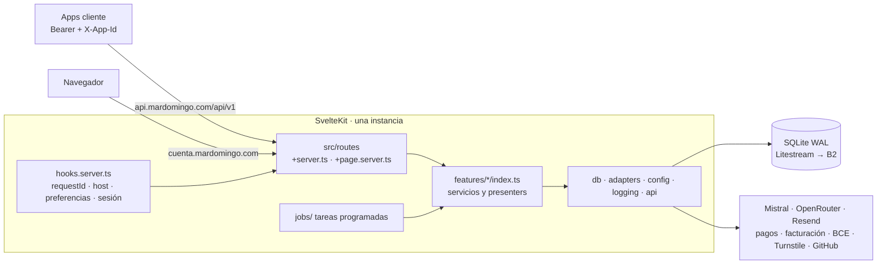
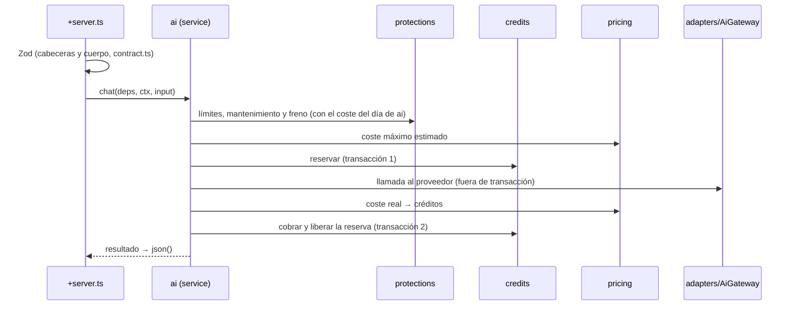

# Arquitectura de Cuenta Mardomingo

Mapa operativo para personas y agentes: dónde va cada cosa, qué puede depender de qué y cómo
fluyen los casos de uso. Concreta la constitución (`.specify/memory/constitution.md`, sobre todo
los principios I, IV, X, XI y XII y la sección «Arquitectura idiomática de SvelteKit») y no la
contradice. Las decisiones y sus alternativas están en `docs/adr/`.

**Principio guía:** la máxima previsibilidad con la mínima complejidad necesaria.

## 1. Vista general

Un **monolito modular** de SvelteKit 2 (una sola instancia, SQLite) que sirve dos hosts:



## 2. Estructura de directorios

```text
src/
  hooks.server.ts            contexto, host, Paraglide, preferencias, app, sesión, cabeceras
  params/                    param matchers
  routes/
    (web)/(public)/…         landings, precios, legales, registro, login
    (web)/panel/…            panel de usuario
    (web)/admin/…            panel de administración
    api/v1/…                 API de las apps (+server.ts)
    client-errors/           errores del navegador
  lib/
    server/
      features/<f>/          una carpeta por funcionalidad (sección 3)
        index.ts             API pública (único fichero obligatorio)
        domain/              puro, sin I/O (puede usar zod y los dos shared/)
        service.ts           casos de uso
        repository.ts        acceso a SUS tablas (y validación de sus columnas JSON)
        schema.ts            solo tablas Drizzle de las que es dueña
        contract.ts          esquemas Zod de su API (entrada, salida, OpenAPI)
        events.ts            catálogo de eventos de log
        presenters.ts        modelos de vista
        *.cache.ts           cachés o contadores deliberados del proceso
        *.int.test.ts        tests de integración de la funcionalidad
      shared/                puro del servidor: ids y errores tipados
      composition.ts         punto de composición (BD, adaptadores, Clock, Logger)
      db/                    cliente, transacción BEGIN IMMEDIATE, migraciones
      adapters/<proveedor>/  interfaz, implementación real y fake.ts
      config/                env.ts y env-schema.ts (único lector del entorno)
      logging/               logger (único importador de pino) y events.ts de infraestructura
      forms/                 helper de formularios
      api/                   formateador de errores 7.1, cabeceras comunes, montaje del OpenAPI
      jobs/                  tareas programadas finas (croner)
    shared/                  puro, cliente y servidor: Micro, EpochMs, CivilDate y constructores
    logging/                 client.ts (único importador de loglevel), tipos y eventos client.*
    schemas/common/          primitivas Zod (lista repetida, decimal español, dd/mm/aaaa)
    schemas/<f>/             esquemas de formularios compartidos con el cliente
    format/                  formato de importes, fechas y números (puro)
    design-system/           tokens y tema: fuente canónica desde L01 (ADR 0007)
    components/ui/           primitivas accesibles genéricas
    components/layout/       marco: cabecera, pie, navegación, menú de cuenta, tema y efectos
    components/<f>/          componentes de una funcionalidad
messages/es.json             textos de Paraglide (claves con prefijo de funcionalidad)
tests/http/                  hooks y API contra el build
tests/architecture/          fronteras, dependencias y reglas estáticas
tests/builders/  tests/mock-servers/
e2e/                         Playwright (ver Historias.md 15.25)
docs/adr/                    decisiones de arquitectura
```

`sv add drizzle` y `sv add better-auth` generan `src/lib/server/db/schema.ts` y
`src/lib/server/auth.ts`: en L01 y L02 su contenido se mueve a `features/accounts/` (y el esquema
de cada tabla a su dueña), y `db/` queda solo con el cliente, las transacciones y las migraciones.

## 3. Funcionalidades

Cada funcionalidad **solo puede depender de las que están antes en la tabla**, y solo de las que
indica su columna. Así el grafo no tiene ciclos. El plan de cada lote fija las aristas reales
dentro de este margen.

| # | Funcionalidad | Responsabilidad | Tablas propias | Requisitos | Puede depender de |
|---|---|---|---|---|---|
| 1 | `audit` | Registro inmutable de las acciones del administrador | `admin_audit` | BE-FR-55 | — |
| 2 | `notifications` | Envío de emails, anuncios y estado de las alertas | `alerts_state`, `announcements` | BE-FR-58, 85 | audit |
| 3 | `apps` | Registro de apps, catálogo de operaciones, plantillas, configuración con herencia global → app → operación, mantenimiento, versiones y soporte | `apps`, `app_operations`, `prompt_templates`, `settings` | BE-FR-47 (datos), 48 (datos), 61, 62, 77, 78, 84 | audit |
| 4 | `legal` | Documentos legales, aceptaciones y declaración de edad | `legal_documents`, `terms_acceptances` | BE-FR-60, 69, 70 | audit, notifications |
| 5 | `pricing` | Tarificación, coste máximo, tipo de cambio y precios orientativos | `price_references`, `fx_rates` | BE-FR-19–22, 72, 73, 87 | apps, audit, notifications |
| 6 | `credits` | Bolsas, saldo, reservas, deuda, caducidad, ajustes, ledger, tope diario, compra real y aviso de saldo bajo | `credit_buckets`, `user_balances`, `credit_holds`, `credit_movements`, `welcome_grants` | BE-FR-11.6, 12–18, 49.7, 71 | apps, audit, notifications |
| 7 | `invoicing` | Datos fiscales, facturas y exportación contable | `billing_profiles`, `invoices` | BE-FR-74–76 | apps, audit, notifications |
| 8 | `accounts` | Better Auth, registro, verificación, sesiones, perfil, cambio de email, antiabuso, límites de autenticación y *guards* | `user`, `session`, `account`, `verification`, `rate_limit` (Better Auth), `login_attempts`, `disposable_domains` | BE-FR-01–06, 09–11 (salvo 11.6), 45, 63–69 | apps, audit, notifications, legal, credits |
| 9 | `payments` | Paquetes, compras, reembolsos y contracargos (bloquean la cuenta) | `packs`, `payments` | BE-FR-23–29 | apps, audit, notifications, credits, invoicing, accounts |
| 10 | `sync` | Documento sincronizado y predeterminados por app | `sync_documents`, `app_defaults` | BE-FR-39–42 | apps, audit |
| 11 | `protections` | Límites por usuario, freno global, comprobación de mantenimiento y de versión | `protection_state` (freno del día y su liberación); contadores en `*.cache.ts` | BE-FR-43, 46, 47, 48 | apps, audit, notifications, credits |
| 12 | `ai` | Pasarela de chat, transcripción e imagen, idempotencia, modelos y alertas de proveedores | `ai_operations`, `model_cache` | BE-FR-30–38, 44, 56, 79–82 | apps, audit, notifications, legal, pricing, credits, protections |
| 13 | `privacy` | Exportación RGPD, borrado de cuenta, cuentas inactivas y retención | — | BE-FR-07, 08, 83, 86 | todas las anteriores |
| 14 | `stats` | Estadísticas y embudo de alta, componiendo las API públicas | `release_downloads` | BE-FR-54 | todas las anteriores |

- **Agregados de una funcionalidad posterior** (p. ej. el coste del día de `ai` para el freno de
  `protections`, o las medianas de `ai` para los precios orientativos de `pricing`): los calcula
  su dueña y los pasa **como parámetro** el servicio o la tarea que orquesta. Nunca se importan.
- `has_real_purchase` y el aviso de saldo bajo (`low_balance_threshold_µc`, `low_balance_notified`)
  viven en `user_balances` (dueña: `credits`). `payments` indica si la compra es simulada al
  acreditarla, y `credits` actualiza la marca.
- `/app/status` lo compone su ruta leyendo las API públicas de `apps`, `notifications` y `legal`.

## 4. Reglas de dependencia

| Desde → Hacia | ¿Permitido? |
|---|---|
| Funcionalidad → `index.ts` de una funcionalidad anterior permitida | Sí |
| Funcionalidad → interior de otra (`domain/`, `repository.ts`, `schema.ts`…) | **No** (salvo `schema.ts` → `schema.ts` para `references()`) |
| Funcionalidad → `$lib/shared`, `$lib/server/{shared,db,config,logging,api}`, `adapters` (por su interfaz) | Sí |
| `domain/` → `zod`, `$lib/shared`, `$lib/server/shared`, su propio `domain/` | Sí; **nada más** |
| Los dos `shared/` → funcionalidades o infraestructura | **No** |
| Rutas, *hooks* y `jobs/` → `index.ts` de las funcionalidades, `forms`, `api`, `logging` | Sí |
| Rutas → `db/` o `adapters/` | **No** |
| `components/layout` → `components/ui`, `$lib/format` | Sí; nada más |
| `components/<f>` → `components/ui`, `$lib/schemas`, `$lib/format`, `$lib/shared` | Sí |
| `components/<f>` → componentes de otra funcionalidad | **No**: lo compartido pasa a `ui/` |
| Código de cliente → `$lib/server/**` | Imposible (SvelteKit lo bloquea) |

```ts
// ✅ Válido
import { reserveCredits } from '$lib/server/features/credits';           // API pública
import { computeCharge } from './domain/charge';                          // dentro de pricing
import type { Micro } from '$lib/shared/money';                           // cliente y servidor

// ❌ Inválido
import { creditBuckets } from '$lib/server/features/credits/schema';     // tabla ajena en un repositorio
import { db } from '$lib/server/db';                                      // en src/routes/**
import { now } from '$lib/server/adapters/clock';                         // en domain/
import { sendEmail } from '$lib/server/features/notifications/service';  // import profundo
import { chargeOperation } from '$lib/server/features/ai';               // desde credits: ai va después
```

## 5. Composición

`src/lib/server/composition.ts` construye una vez, desde el hook `init`, la conexión a la BD, los
adaptadores (reales o falsos según `APP_ENV`), el `Clock` y el `Logger` raíz. Las rutas, los
*hooks* y las tareas obtienen de ahí lo que necesitan y lo pasan a los servicios **por parámetro**;
el `Logger` llega ya enriquecido con el contexto de la petición (`event.locals`). Los servicios no
importan la composición ni leen el entorno. En los tests se construye con los falsos.

## 6. Flujos habituales

**Operación de IA** (`POST /api/v1/ai/chat`, sección 8 de `Historias.md`):



**Compra simulada:** action de la página de compra → `payments` abre la transacción → `credits`
acredita la bolsa (simulada) e `invoicing` (proveedor `none`) no emite factura →
POST-redirect-GET. Idempotente por el identificador de intento (BE-FR-25 CA4).

**Form action de la web:** *guard* de `accounts` → helper de formularios (Zod) → **un** servicio
por `index.ts` → `redirect(303)` o `fail(4xx)` (constitución, «Mutaciones: form actions»).

**Preferencias de apariencia:** `handle` lee las cookies de tema y efectos (Zod) y las deja en
`event.locals`; el layout raíz pinta `data-theme` y `data-effects` desde el servidor; el selector
es un formulario con su action, que guarda la cookie y vuelve a un `redirectTo` interno; con
JavaScript se aplica sin recargar (`Historias.md` 16.4, DS-03).

## 7. Dónde va cada cosa

| Quiero… | Va en… |
|---|---|
| Una regla de negocio pura (cálculo, validación de estado) | `features/<f>/domain/` |
| Un caso de uso que lee, escribe o llama a un proveedor | `features/<f>/service.ts` |
| Una tabla nueva | `features/<f>/schema.ts` de su dueña, más una migración |
| Datos de otra funcionalidad | Una función en el `index.ts` de la dueña (o un parámetro, si va después) |
| El esquema de un endpoint de la API | `features/<f>/contract.ts`, registrado en el OpenAPI de `api/` |
| El esquema de una columna JSON | Junto al `repository.ts` de su dueña |
| El esquema de la respuesta de un proveedor | `adapters/<proveedor>/` |
| El esquema de un formulario compartido con el cliente | `$lib/schemas/<f>/` (primitivas en `$lib/schemas/common/`) |
| Un proveedor externo nuevo | `adapters/<proveedor>/` con interfaz, real y `fake.ts` |
| Un tipo o helper puro usado por cliente y servidor | `$lib/shared/` |
| Un tipo o helper puro usado por varias funcionalidades del servidor | `$lib/server/shared/` |
| Una caché o un contador del proceso | `features/<f>/*.cache.ts` |
| Un evento de log | `features/<f>/events.ts` (infraestructura: `logging/events.ts`) |
| Un endpoint de la API | `src/routes/api/v1/…/+server.ts` |
| Una pantalla | `src/routes/(web)/…` con `+page.server.ts` y componentes en `components/<f>/` |
| Un componente reutilizable o del marco | `components/ui/` o `components/layout/`, con tokens de `design-system/` |
| Una tarea programada | `jobs/`, que solo llama a API públicas |
| Un texto visible | `messages/es.json`, con clave `<f>_…` |

## 8. Convenciones para no generar código anticuado

Los modelos de IA tienden a reproducir APIs antiguas. Con las versiones fijadas en la constitución:

| Tecnología | Usar | No introducir |
|---|---|---|
| Svelte 5 | runes (`$state`, `$derived`, `$props`), *snippets*, `onclick` | `export let`, `$:`, slots, `on:click`, `createEventDispatcher` |
| SvelteKit 2 | `$app/state`, `resolve()`, `error()`/`redirect()` sin `throw` | `$app/stores`, `throw redirect()`, rutas escritas a mano |
| Tailwind 4 | `@import "tailwindcss"` y `@theme` en el CSS, `@tailwindcss/vite` | `tailwind.config.js`, `@tailwind base`, plugin de PostCSS |
| ESLint 10 | configuración *flat* (`eslint.config.js`) | `.eslintrc*`, `--cache` |
| Zod 4 | `z.email()`, `z.uuid()`, `z.int()`, `z.strictObject`, parámetro `error` | `z.string().email()`, `errorMap`, `invalid_type_error`, `z.coerce.number()` en importes |
| Vitest 5 | `test.projects` en la configuración | fichero `vitest.workspace` |
| Drizzle 0.45 | *query builder* (`db.select()…`), índices como array en `sqliteTable` | API relacional `db.query` (exige reunir todos los esquemas), `drizzle-kit push` en staging o producción |
| Paraglide 2 | `m.clave()` de `$lib/paraglide/messages`, `paraglideMiddleware` en `handle` | el adaptador antiguo `@inlang/paraglide-sveltekit` |

## 9. Patrones

**Seguir:** los de la constitución (runes, form actions con `use:enhance`, `load` solo en servidor,
Zod en cada frontera, enteros para el dinero, transacciones síncronas, adaptadores con
implementación falsa, `resolve()`, filtros por formulario GET, controles nativos).

**Evitar:** lógica en rutas o componentes, imports profundos entre funcionalidades, repositorios
genéricos o «servicios base» sin un segundo uso real, eventos o colas internas, cachés sin medir,
`as` en lugar de validar, estado mutable a nivel de módulo, `fetch` desde componentes y librerías
nuevas que dupliquen una existente.

## 10. Trabajo en paralelo (personas y agentes)

- Una rama por lote o funcionalidad. Los cambios dentro de `features/<f>/` son independientes.
- Cambiar el `index.ts` de una funcionalidad afecta a quien la usa: el plan lo anota y busca a los
  consumidores. Cambiar `$lib/shared` o un `index.ts` amplía la selección de tests (15.24).
- **Ficheros de contención** (añadir solo líneas, sin reordenar):
  - migraciones: se generan solo después de actualizar la rama con `main`; si hay conflicto, se
    borra la migración propia y se vuelve a generar; nunca se editan las ya integradas;
  - `messages/es.json`: claves con prefijo de la funcionalidad, agrupadas por ella;
  - `logging/events.ts` y el montaje del OpenAPI en `api/`: una línea por funcionalidad;
  - el *seed* de `settings`: una sección por funcionalidad.
- drizzle-kit lee `features/*/schema.ts` por patrón y no se usa la API relacional, así que no hace
  falta un fichero que reúna todos los esquemas.

## 11. Verificación automática

La lista canónica de reglas comprobadas está en la constitución («Verificación de esta sección» de
la arquitectura de SvelteKit, principios XI y XII, y puertas del CI). Resumen:

| Regla | Documento | Herramienta |
|---|---|---|
| Dominio y `shared/` sin I/O ni otras funcionalidades | Principio IV | ESLint |
| Solo `index.ts` entre funcionalidades, orden y grafo sin ciclos, dueños de tablas | Principio IV | Test de arquitectura |
| Sin `as`, sin `$app/stores`, rutas sin `db/` ni `adapters/` | XII, SvelteKit | ESLint |
| Un solo lector del entorno, `z.object` en layouts, sin `prerender` | Configuración, XII | Test de arquitectura |
| Estado de módulo solo en `*.cache.ts` | SvelteKit | Test de arquitectura |
| Eventos únicos y con prefijo; `pino`/`loglevel` aislados; `no-console` | XI | Test de arquitectura y ESLint |
| Imports entre componentes | SvelteKit | Test de arquitectura |
| Sin colores literales ni paleta de Tailwind | XIII | `lint:tokens` (puerta 10) |
| Cobertura del 100 % en `domain/` y en los dos `shared/` | V | Vitest con umbrales |

Lo que no se puede comprobar automáticamente (calidad de los nombres, abstracciones
injustificadas) lo revisa el «Architecture Check» del plan.

## 12. Architecture Check (obligatorio en cada `plan.md`)

Se añade al plan después del «Constitution Check».

- [ ] Cumple la constitución (Constitution Check) sin violaciones injustificadas.
- [ ] Cada fichero nuevo está en la ubicación de la sección 7.
- [ ] Solo usa el `index.ts` de funcionalidades anteriores permitidas (indica las aristas nuevas);
      los agregados de funcionalidades posteriores llegan por parámetro.
- [ ] Cada tabla nueva tiene un dueño; ningún repositorio toca tablas ajenas.
- [ ] Las transacciones las abre el servicio que orquesta; sin `await` dentro.
- [ ] Reutiliza lo que existe (`ui/`, `layout/`, adaptadores, helpers) antes de crear algo nuevo.
- [ ] Cada abstracción, capa o dependencia nueva explica qué problema concreto resuelve.
- [ ] Los eventos nuevos están en el `events.ts` de su funcionalidad.
- [ ] La estrategia de tests sigue `Historias.md` 15 (lotes, niveles, `CA` → test).
- [ ] Interfaz: componentes en `ui/`, `layout/` o `<f>/` con tokens (sin literales ni paleta de
      Tailwind); enlaces con `resolve()`; filtros por GET; nada crítico depende de JavaScript salvo
      el captcha; estados de 16.6 y criterios UX-xx aplicables identificados.
- [ ] Seguridad: autorización en cada action y endpoint, validación en las fronteras, sin datos
      internos en los modelos de vista.
- [ ] Impacto en otras funcionalidades y en el OpenAPI identificado.
- [ ] Si rompe una regla: se cambia el diseño, o hay un ADR (y una enmienda si toca la
      constitución).

## 13. Riesgos conocidos

| Riesgo | Mitigación |
|---|---|
| Aparecen ciclos al implementar (p. ej. una funcionalidad necesita datos de otra posterior) | Pasar el dato por parámetro; si no basta, revisar el orden con un ADR |
| El test de arquitectura es frágil con los alias de `$lib` | Resolver los imports con el compilador de TypeScript, no con expresiones regulares |
| Crece el número de funcionalidades o una se vuelve demasiado grande | Dividirla en el plan y actualizar la sección 3 |
| Los ficheros de contención generan conflictos | Reglas de la sección 10 |
| El modelo genera APIs antiguas | Sección 8, ESLint y `svelte-check` sin avisos |

## 14. Decisiones pospuestas

| Decisión | Se revisa si… |
|---|---|
| Herramienta específica de fronteras (dependency-cruiser, eslint-plugin-boundaries) | El test de arquitectura se vuelve difícil de mantener |
| Dividir el monolito o añadir procesos | Nunca sin enmendar el principio X; señal: una carga que no cabe en una instancia |
| Paquetes de monorepo | Aparece un segundo despliegue o una librería compartida con otra app |
| Caché, colas o eventos internos | Una medición demuestra un problema que no se resuelve de forma más simple |
| Migrar a SvelteKit 3 | Better Auth lo soporte (ADR 0001) |
